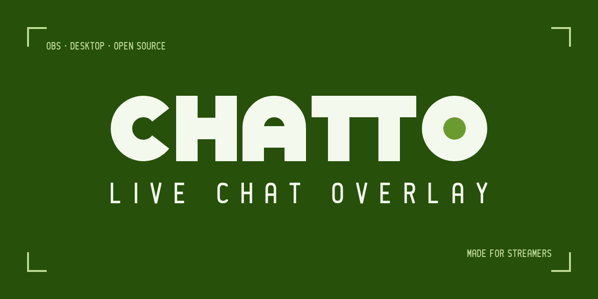

<p align="center">English · <a href="CONTRIBUTING.zh-TW.md">繁體中文</a></p>

<p align="center">
  
</p>

# Developing Chatto

How to build, test and release Chatto. For what Chatto is and how to use it, see the [README](README.md).

## Before you start

- Bugs and ideas start as a [GitHub issue](https://github.com/ShiroOYuki/Chatto/issues) with the problem or the proposed behavior, so details can be settled before code is written.
- Branch from `develop` (`feature/<name>`) and open pull requests against `develop`.
- Commits follow [Conventional Commits](https://www.conventionalcommits.org/) with the package as the scope, for example `feat(provider-twitch): ...` or `fix(chat-ui): ...`. Reference the issue with `Refs #N` or `Closes #N`.
- New dependencies must have a license compatible with GPL-3.0 and go into [THIRD_PARTY_NOTICES.md](THIRD_PARTY_NOTICES.md).

## Setup

Requires Node.js 22+ and Windows 10/11.

```bash
npm install
cp apps/desktop/.env.example apps/desktop/.env   # optional: a built-in Twitch Client ID
npm run dev                                       # start the desktop app
```

### Twitch Client ID

1. Create an application in the [Twitch Developer Console](https://dev.twitch.tv/console/apps).
2. Set **Client Type to Public**. Chatto uses the Device Code Flow and never needs or stores a client secret.
3. The OAuth Redirect URL can be `http://localhost`; the Device Code Flow does not use it.
4. Put it in `MAIN_VITE_TWITCH_CLIENT_ID` in `apps/desktop/.env`. It is built into the app, so users do not have to set one up. Without a built-in ID, users enter their own on the Accounts page.

With a built-in Client ID, users can still switch to their own under “Advanced settings” on the Twitch card of the Accounts page, or in Settings → Advanced, and switch back. A Client ID is public information and safe to ship in the installer.

### Preview without the app

```bash
npm run dev:viewer   # http://localhost:5174/overlay?mock=1&backdrop=1&theme=washi
npm run dev:web      # the control panel in a browser with mock data: http://localhost:5175
```

## Commands

| Command                    | What it does                                                                      |
| -------------------------- | --------------------------------------------------------------------------------- |
| `npm run dev`              | Build the viewer and start Electron                                               |
| `npm run typecheck`        | Type-check every workspace                                                        |
| `npm test`                 | Vitest unit and component tests                                                   |
| `npm run test:e2e`         | Playwright web E2E for the control panel and viewer                               |
| `npm run test:visual`      | Playwright visual regression for themes and the control panel                     |
| `npm run test:electron`    | Build, then test the Electron app with Playwright                                 |
| `npm run test:all`         | Type-check plus every test suite                                                  |
| `npm run build`            | Build the viewer and the desktop app                                              |
| `npm run build:obs-plugin` | Build the OBS plugin (needs the VS 2022 Build Tools C++ workload and Windows SDK) |
| `npm run dist`             | Package the Windows installer, OBS plugin included, into `apps/desktop/release/`  |

Before finishing a change, run `npm run typecheck`, `npm test` and the Playwright tests related to it. The full E2E, visual and Electron suites run in CI. New features come with tests; bug fixes start with a failing test. See [docs/testing.md](docs/testing.md).

## Project structure

```
packages/core             Standard chat format, provider interface, theme schema, WebSocket protocol
packages/provider-twitch  Twitch: Device Code Flow, EventSub, Helix
packages/chat-ui          Themeable chat renderer and built-in themes
packages/share            Theme sharing: data format, checks, API client, legal texts
apps/viewer               The /overlay and /embed pages
apps/desktop              Electron app: control panel, local server, overlay windows
apps/share-worker         Theme sharing service (Cloudflare Worker, D1, R2)
apps/site                 chattolive.com: home, themes, guide, FAQ, changelog, terms
obs-plugin                OBS plugin “Chatto Chat” (C++, CMake)
docs/                     Design documents (see below)
```

Data flows `Provider → ChatHub (main process) → local WebSocket → viewer (overlay windows and OBS)`. Every platform outputs the same `ChatEvent`, so the renderer, themes and transport never depend on a platform’s own payloads.

### Documentation

The design documents are in Traditional Chinese.

| Document                                           | Covers                                                        |
| -------------------------------------------------- | ------------------------------------------------------------- |
| [docs/architecture.md](docs/architecture.md)       | Processes, output routing, local server, OBS plugin, sharing  |
| [docs/message-format.md](docs/message-format.md)   | The standard chat format, event fields and WebSocket protocol |
| [docs/theming.md](docs/theming.md)                 | Theme schema, parameters and the stable `chatto-*` classes    |
| [docs/testing.md](docs/testing.md)                 | Test layers and how to write them                             |
| [docs/design.md](docs/design.md)                   | Control panel visuals and interaction                         |
| [docs/visual-identity.md](docs/visual-identity.md) | Brand, mascot, logo and illustration                          |
| [docs/share-service.md](docs/share-service.md)     | Theme sharing API, local development and deployment           |

## Branches and CI

Branches merge in the order `feature/*` → `develop` → `CI` → `main`.

| Branch                 | On push or pull request                                                                                            |
| ---------------------- | ------------------------------------------------------------------------------------------------------------------ |
| `feature/*`, `develop` | No workflows                                                                                                       |
| `CI`                   | CI: typecheck, unit and component tests, web E2E, visual regression, Electron; builds the OBS plugin if it changed |
| `main`                 | CI; on push, a release once CI passes                                                                              |

`CI` and `main` are protected: they only take pull requests, and CI must pass.

## Releasing

1. On `develop`, raise the version in `package.json`, `apps/desktop/package.json` and `package-lock.json`.
2. In `apps/site/src/changelog.mjs`, turn the “next version” entry (`upcoming: true`) into this version and date. The release notes are generated from it; a release without an entry fails.
3. Merge through `CI` into `main`. Once CI passes on `main`, `.github/workflows/release.yml` reads the version from `apps/desktop/package.json`. If the `v<version>` tag already exists it does nothing; otherwise it builds the OBS plugin and the installer, tags the commit and creates a **draft** release with the installer attached.
4. Publish the draft on GitHub. `site.yml` then deploys the website.

If a release fails, run Release on `main` again from the Actions page.

Releases also carry `latest.yml` and `.blockmap`. Installed copies of Chatto (`electron-updater`) read the latest **published** release at startup and every 6 hours, offer the update in the title bar and in Settings → About, and download it only when the user agrees. Drafts are never offered.

The built-in Client ID comes from the repository variable `TWITCH_CLIENT_ID` (Settings → Secrets and variables → Actions → Variables). It is public, so it is a variable rather than a secret.

## License

By contributing, you agree that your contributions are licensed under [GPL-3.0-or-later](LICENSE).
