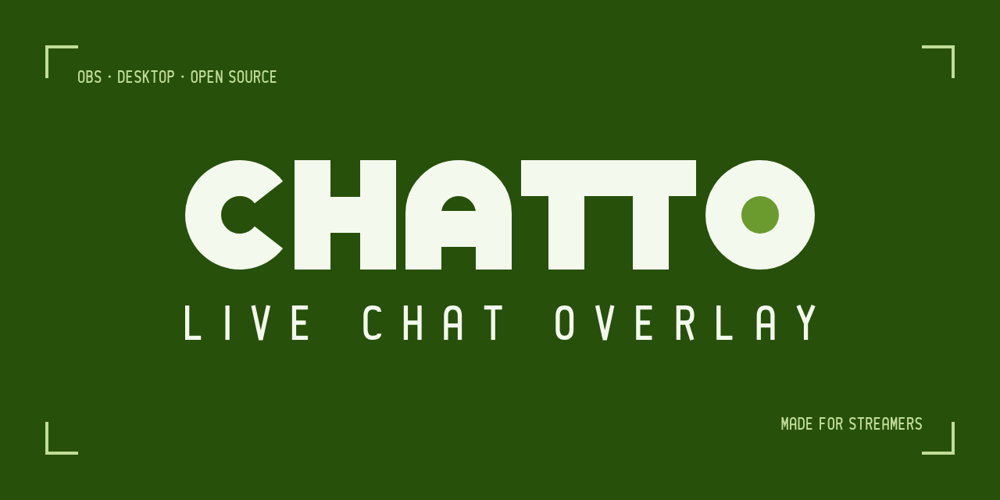

<p align="center"><a href="CONTRIBUTING.md">English</a> · 繁體中文</p>

<p align="center">
  
</p>

# 開發 Chatto

建置、測試與發佈 Chatto 的方式。Chatto 是什麼、怎麼用，見 [README](README.zh-TW.md)。

## 開始之前

- 問題與想法先開 [GitHub issue](https://github.com/ShiroOYuki/Chatto/issues)，寫下問題或希望的行為，細節確定後再寫程式。
- 從 `develop` 開分支（`feature/<名稱>`），pull request 的目標是 `develop`。
- commit 使用 [Conventional Commits](https://www.conventionalcommits.org/)，scope 用 package 名，例如 `feat(provider-twitch): ...`、`fix(chat-ui): ...`。用 `Refs #N` 或 `Closes #N` 連到 issue。
- 新增的第三方套件，授權要和 GPL-3.0 相容，並記到 [THIRD_PARTY_NOTICES.md](THIRD_PARTY_NOTICES.md)。

## 環境

需求：Node.js 22+、Windows 10/11。

```bash
npm install
cp apps/desktop/.env.example apps/desktop/.env   # 可選：填入內建的 Twitch Client ID
npm run dev                                       # 啟動桌面 App
```

### Twitch Client ID

1. 到 [Twitch Developer Console](https://dev.twitch.tv/console/apps) 建立應用程式。
2. **Client Type 選 Public**。Chatto 使用 Device Code Flow，不需要也不會存放 client secret。
3. OAuth Redirect URL 可填 `http://localhost`（Device Code Flow 不會用到）。
4. 寫在 `apps/desktop/.env` 的 `MAIN_VITE_TWITCH_CLIENT_ID`，建置時會內建進 App，使用者不用自己設定；沒有內建值時，使用者在帳號頁填入自己的。

內建 Client ID 時，使用者仍可在帳號頁 Twitch 卡片的「進階設定」或設定頁的「進階」改用自己的 Client ID，也能改回內建。Client ID 是公開資訊，可以放進安裝檔。

### 不開 App 預覽

```bash
npm run dev:viewer   # http://localhost:5174/overlay?mock=1&backdrop=1&theme=washi
npm run dev:web      # 控制台在瀏覽器執行（使用假資料）http://localhost:5175
```

## 指令

| 指令                       | 說明                                                                    |
| -------------------------- | ----------------------------------------------------------------------- |
| `npm run dev`              | 建置 viewer 並啟動 Electron                                             |
| `npm run typecheck`        | 所有 workspace 型別檢查                                                 |
| `npm test`                 | Vitest 單元與元件測試                                                   |
| `npm run test:e2e`         | Playwright：控制台與 viewer 的網頁 E2E                                  |
| `npm run test:visual`      | Playwright：主題與控制台的視覺回歸                                      |
| `npm run test:electron`    | 建置後以 Playwright 測試 Electron App                                   |
| `npm run test:all`         | 型別檢查加上所有測試                                                    |
| `npm run build`            | 建置 viewer 與桌面 App                                                  |
| `npm run build:obs-plugin` | 建置 OBS 外掛（需要 VS 2022 Build Tools 的 C++ 工作負載與 Windows SDK） |
| `npm run dist`             | 打包 Windows 安裝檔（含 OBS 外掛，輸出到 `apps/desktop/release/`）      |

完成改動前，在本機跑 `npm run typecheck`、`npm test` 和相關的 Playwright 測試；完整的 E2E、視覺回歸、Electron 測試由 CI 執行。新功能要附測試，修 bug 時先寫一個會失敗的測試。詳見 [docs/testing.md](docs/testing.md)。

## 專案結構

```
packages/core             標準化聊天格式、Provider 介面、主題 schema、WebSocket 協定
packages/provider-twitch  Twitch：Device Code Flow、EventSub、Helix
packages/chat-ui          可主題化的聊天渲染器與內建主題
packages/share            主題分享：資料格式、檢查規則、API 用戶端、條款文字
apps/viewer               /overlay 與 /embed 頁面
apps/desktop              Electron 桌面 App（控制台、本機伺服器、Overlay 視窗）
apps/share-worker         主題分享服務（Cloudflare Worker、D1、R2）
apps/site                 chattolive.com 網站（首頁、主題、教學、常見問題、更新紀錄、條款）
obs-plugin                OBS 外掛「Chatto 聊天室」（C++，CMake）
docs/                     設計文件（見下表）
```

資料流：`Provider → ChatHub（main process）→ 本機 WebSocket → viewer（Overlay 視窗與 OBS）`。所有平台都輸出同一種 `ChatEvent`，渲染器、主題與傳輸層不依賴任何平台的原生資料。

### 文件

| 文件                                               | 內容                                       |
| -------------------------------------------------- | ------------------------------------------ |
| [docs/architecture.md](docs/architecture.md)       | 行程、輸出路由、本機伺服器、OBS 外掛、分享 |
| [docs/message-format.md](docs/message-format.md)   | 標準化聊天格式、事件欄位、WebSocket 協定   |
| [docs/theming.md](docs/theming.md)                 | 主題 schema、參數、穩定的 `chatto-*` class |
| [docs/testing.md](docs/testing.md)                 | 測試分層與寫法                             |
| [docs/design.md](docs/design.md)                   | 控制台的視覺與互動                         |
| [docs/visual-identity.md](docs/visual-identity.md) | 品牌、吉祥物、標誌與插圖                   |
| [docs/share-service.md](docs/share-service.md)     | 主題分享 API、本機開發與部署               |

## 分支與 CI

分支依 `feature/*` → `develop` → `CI` → `main` 的順序合併。

| 分支                   | 推送或 PR 時                                                                                 |
| ---------------------- | -------------------------------------------------------------------------------------------- |
| `feature/*`、`develop` | 不跑任何 workflow                                                                            |
| `CI`                   | 跑 CI（typecheck、單元與元件測試、web E2E、視覺回歸、Electron）；動到 OBS 外掛時另外建置外掛 |
| `main`                 | 跑 CI；推送時 CI 通過後接著發佈                                                              |

`CI` 與 `main` 受分支保護：只能透過 PR 合併，且 CI 必須通過。

## 發佈

1. 在 `develop` 提高 `package.json`、`apps/desktop/package.json`、`package-lock.json` 的版本號。
2. 把 `apps/site/src/changelog.mjs` 裡「下一版」那筆（`upcoming: true`）改成這個版本與日期。Release 說明由它產生，沒有這個版本的紀錄時 Release 會失敗。
3. 一路經過 `CI` 合併到 `main`。`main` 的 CI 通過後，`.github/workflows/release.yml` 讀 `apps/desktop/package.json` 的版本：`v<版本>` tag 已存在就不做事；否則建置 OBS 外掛與安裝檔，打上 tag，建立附上安裝檔的**草稿** Release。
4. 在 GitHub 發佈草稿，`site.yml` 會接著部署網站。

發佈失敗時，可以在 Actions 頁面對 `main` 手動執行 Release 重試。

Release 同時附上 `latest.yml` 與 `.blockmap`：已安裝的 Chatto（`electron-updater`）啟動時與每 6 小時讀最新一份**已發佈**的 Release，在標題列與設定頁「關於」提示更新，使用者同意後才下載。草稿不會被讀到。

內建的 Client ID 來自 repository variable `TWITCH_CLIENT_ID`（Settings → Secrets and variables → Actions → Variables）。它是公開值，所以用 variable 而不是 secret。

## 授權

貢獻的程式碼以 [GPL-3.0-or-later](LICENSE) 授權。
