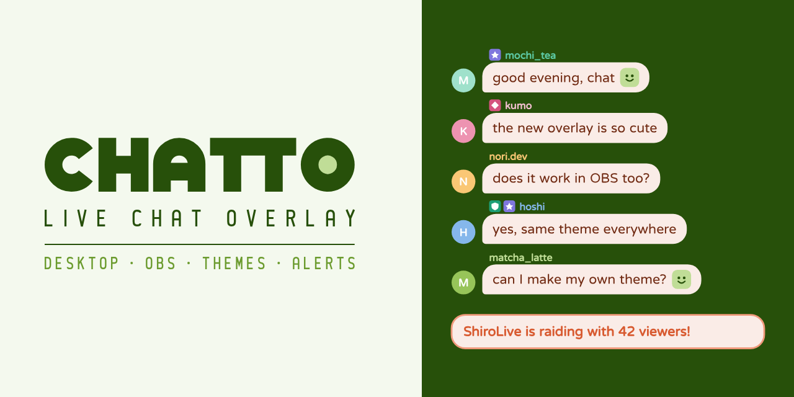

<a href="README.md">English</a> · <a href="README.zh-TW.md">繁體中文</a> · 日本語

  

<b>チャットをデスクトップと OBS に。</b> Windows 向けの無料・オープンソースの配信チャットオーバーレイ。

  <a href="https://github.com/ShiroOYuki/Chatto/releases/latest"><b>Windows 版をダウンロード</b></a>
  ·
  <a href="https://chattolive.com/ja/">ウェブサイト</a>
  ·
  <a href="https://chattolive.com/ja/guide">使い方</a>
  ·
  <a href="https://chattolive.com/ja/faq">よくある質問</a>

---

## できること

- **デスクトップオーバーレイ**：ゲームの上に重ねて表示できる透明なチャットウィンドウ。常に最前面に表示され、クリックは下のウィンドウに通ります。ロックを外すと移動やサイズ変更ができます。
- **OBS ソース**：「Chatto チャット」ソースを追加するだけで、URL の貼り付けは不要です。ソースごとに別のテーマを使えます。Chatto を閉じている間は待機画面を表示します。通常のブラウザソースでも使えます。
- **テーマ**：7種類の内蔵テーマはすべて調整できます。余白、角の丸み、枠線、画像フレーム、ロールごとのスタイルをプレビューを見ながら変更でき、自分で CSS を書いたり、テーマをエクスポートして共有したりできます。
- **見つける**：ほかの配信者が共有したテーマを探してインストールしたり、自分のテーマを投稿したりできます。
- **自分にだけ見えるアラート**：Raid、サブスク、チャンネルポイントの引き換えをデスクトップにカードで表示します。チャットがしばらく静かだったあとに誰かが書き込むとお知らせします。どれも配信画面には映りません。
- **すぐに消える**：モデレーターが削除したメッセージや、発言禁止・追放されたユーザーのメッセージは、オーバーレイと OBS からすぐに消えます。
- **英語、繁体字中国語、日本語**に対応。アップデートはアプリ内でお知らせします。

## はじめかた

1. [ダウンロード](https://github.com/ShiroOYuki/Chatto/releases/latest)してインストーラーを実行します。OBS で使う場合は「OBS プラグインをインストールする」にチェックを入れてください。
2. **アカウント**ページを開き、配信プラットフォームにログインします。プレビューにチャットが表示されます。
3. デスクトップオーバーレイをオンにするか、OBS に「Chatto チャット」ソースを追加します。

各手順は[使い方](https://chattolive.com/ja/guide)で、よくある質問は[よくある質問](https://chattolive.com/ja/faq)で説明しています。

Chatto は Windows 10 以降で動作します。現在は Twitch のチャットに対応しており、YouTube と Kick にも対応予定です。

## 知っておくこと

- 排他的フルスクリーンのゲームは、オーバーレイを含むすべてのウィンドウより前面に表示されます。ボーダーレスウィンドウモードを使ってください。
- Chatto のローカルサーバーは `127.0.0.1` でのみ待ち受けるため、同じネットワーク上のほかの端末からは読み取れません。
- Chatto は利用状況のデータを収集しません。テーマ共有で Chatto アカウントが必要なのは、投稿、いいね、報告のときだけです。詳しくは[プライバシーに関する説明](https://chattolive.com/ja/privacy)をご覧ください。

## Chatto を応援する

Chatto は無料です。気に入ったら、Ciel にお茶を一杯ごちそうしてください：

- [Ko-fi](https://ko-fi.com/ciel518)（海外向け）
- [ECPay](https://p.ecpay.com.tw/C487EF9)（台湾向け）

不具合やアイデアがあれば、[Issue を作成](https://github.com/ShiroOYuki/Chatto/issues)するか、support@chattolive.com までメールでお知らせください。

## 開発者向け

Chatto のビルド、テスト、リリースの方法とコードの構成は [CONTRIBUTING.md](CONTRIBUTING.md)（英語）にまとめています。

## ライセンス

[GPL-3.0-or-later](LICENSE) © 2026 Ciel。サードパーティのライセンス表記は [THIRD_PARTY_NOTICES.md](THIRD_PARTY_NOTICES.md) にあります。

Chatto は、いずれの配信プラットフォームおよび OBS Project とも提携していません。
