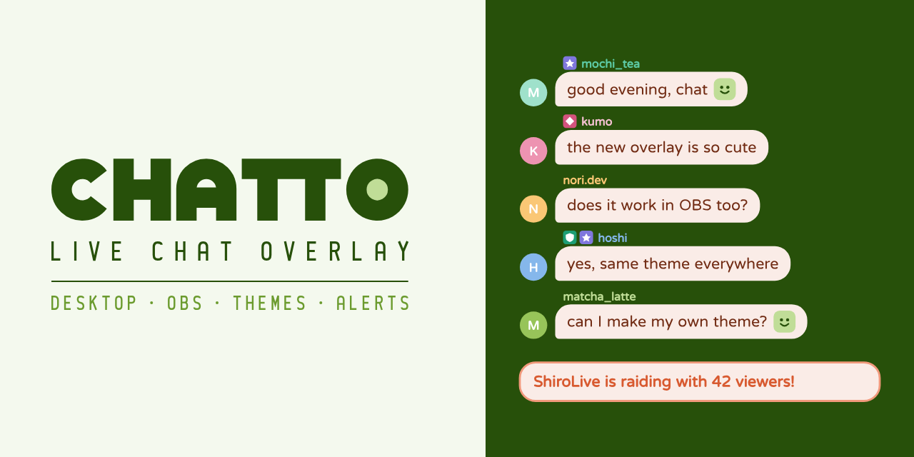

English · <a href="README.zh-TW.md">繁體中文</a>

  

<b>Chat on your desktop and in OBS.</b> A free and open source live chat overlay for Windows.

  <a href="https://github.com/ShiroOYuki/Chatto/releases/latest"><b>Download for Windows</b></a>
  ·
  <a href="https://chattolive.com">Website</a>
  ·
  <a href="https://chattolive.com/guide">Guide</a>
  ·
  <a href="https://chattolive.com/faq">FAQ</a>

---

## What it does

- **Desktop overlay**: a see-through chat window that stays on top of your game while clicks pass straight through. Unlock it to move or resize it.
- **OBS source**: add a “Chatto Chat” source with no URL to paste, and give each source its own theme. While Chatto is closed, it shows a waiting screen. Plain browser sources work too.
- **Themes**: seven built-in themes, all adjustable. Change padding, corners, borders, image frames and role styles while you watch, write your own CSS, and export a theme to share it.
- **Explore**: browse and install themes other streamers have shared, and publish your own.
- **Alerts only you see**: raids, subs and channel points redemptions pop up as cards on your desktop, and you get a nudge when someone writes after chat has gone quiet. None of it shows on stream.
- **Instant removal**: messages that moderators delete or ban disappear from the overlay and OBS right away.
- **English and Traditional Chinese**, with updates offered inside the app.

## Get started

1. [Download](https://github.com/ShiroOYuki/Chatto/releases/latest) and run the installer. To use Chatto in OBS, check “Install the OBS plugin”.
2. Open the **Accounts** page and sign in to your streaming platform. Chat appears in the preview.
3. Turn on the desktop overlay, or add a “Chatto Chat” source in OBS.

The [guide](https://chattolive.com/guide) walks through each step, and the [FAQ](https://chattolive.com/faq) covers common questions.

Chatto runs on Windows 10 and later. It reads chat from Twitch today; YouTube and Kick are planned.

## Good to know

- Games in exclusive fullscreen cover every window, the overlay included. Use borderless windowed mode instead.
- Chatto’s local server only listens on `127.0.0.1`, so other devices on your network cannot read it.
- Chatto collects no usage data. Theme sharing needs a Chatto account only to publish, like or report; see the [privacy notice](https://chattolive.com/privacy).

## Support Chatto

Chatto is free. If you like it, you can buy Ciel a cup of tea:

- [Ko-fi](https://ko-fi.com/ciel518) (international)
- [ECPay](https://p.ecpay.com.tw/C487EF9) (Taiwan)

Found a bug or have an idea? [Open an issue](https://github.com/ShiroOYuki/Chatto/issues), or email support@chattolive.com.

## For developers

How to build, test and release Chatto, and how the code is organized: [CONTRIBUTING.md](CONTRIBUTING.md).

## License

[GPL-3.0-or-later](LICENSE) © 2026 Ciel. Third-party notices are in [THIRD_PARTY_NOTICES.md](THIRD_PARTY_NOTICES.md).

Chatto is not affiliated with any streaming platform or the OBS Project.
