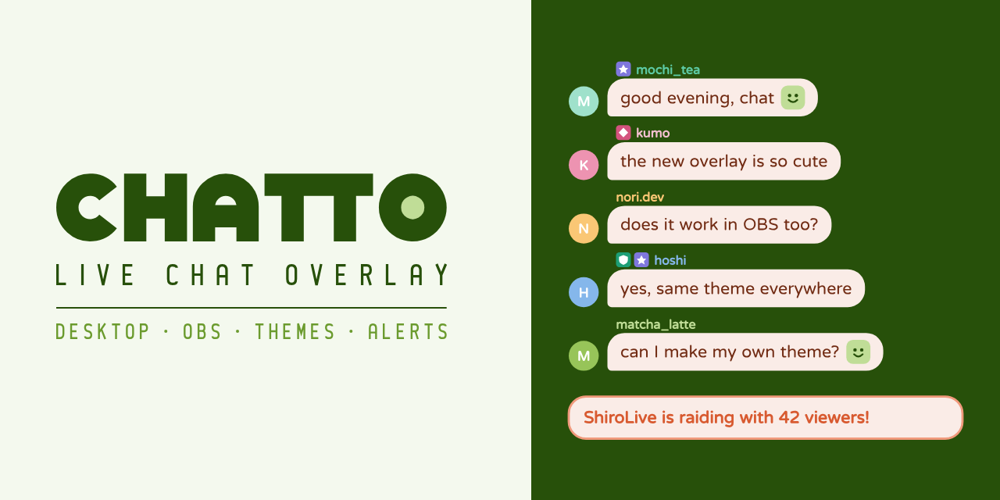

<a href="README.md">English</a> · 繁體中文

  

<b>在桌面和 OBS 顯示聊天室。</b> 免費開源的 Windows 直播聊天室 Overlay。

  <a href="https://github.com/ShiroOYuki/Chatto/releases/latest"><b>下載 Windows 版</b></a>
  ·
  <a href="https://chattolive.com/zh-tw">網站</a>
  ·
  <a href="https://chattolive.com/zh-tw/guide">教學</a>
  ·
  <a href="https://chattolive.com/zh-tw/faq">常見問題</a>

---

## 功能

- **桌面 Overlay**：透明的聊天室視窗，疊在遊戲上面，滑鼠直接穿過去。要移動或縮放時解鎖就好。
- **OBS 來源**：新增「Chatto 聊天室」來源，不用貼網址，每個來源各選一個主題；Chatto 沒開時顯示等待畫面。也可以用一般的瀏覽器來源。
- **主題**：內建七種主題，每一項都能調。內距、圓角、框線、外框圖片、身分樣式改了馬上看到，也能直接寫 CSS，做好的主題可以匯出給別人。
- **探索**：瀏覽、安裝其他實況主分享的主題，也能投稿自己的主題。
- **只有你看得到的提醒**：揪團、訂閱、忠誠點數兌換會在桌面角落跳出卡片；聊天室安靜一陣子後有人留言，也會提醒你。這些都不會出現在直播畫面上。
- **即時移除**：被管理員刪除或封鎖的訊息，會立刻從 Overlay 和 OBS 消失。
- **繁體中文、英文與日文介面**，有新版本時在 App 裡提示更新。

## 開始使用

1. [下載](https://github.com/ShiroOYuki/Chatto/releases/latest)並執行安裝檔。要在 OBS 用，安裝時勾選「安裝 OBS 外掛」。
2. 打開「**帳號**」頁，登入直播平台，預覽裡就會出現聊天。
3. 開啟桌面 Overlay，或在 OBS 新增「Chatto 聊天室」來源。

每一步的說明見[教學](https://chattolive.com/zh-tw/guide)，常見的疑問見[常見問題](https://chattolive.com/zh-tw/faq)。

Chatto 支援 Windows 10 以上。目前讀取 Twitch 聊天室，YouTube、Kick 規劃中。

## 注意事項

- 遊戲若使用「獨佔全螢幕」，所有視窗（包括 Overlay）都會被蓋住，請改用「無邊框視窗」。
- 本機伺服器只綁定 `127.0.0.1`，區網內其他裝置讀不到。
- Chatto 不蒐集使用資料。主題分享只有投稿、按讚、檢舉時需要 Chatto 帳號，詳見[隱私說明](https://chattolive.com/zh-tw/privacy)。

## 支持 Chatto

Chatto 免費。喜歡的話，可以請 Ciel 喝杯茶：

- [Ko-fi](https://ko-fi.com/ciel518)（國際付款）
- [綠界](https://p.ecpay.com.tw/C487EF9)（台灣付款）

發現問題或有想法？請[開 issue](https://github.com/ShiroOYuki/Chatto/issues)，或寄信到 support@chattolive.com。

## 給開發者

建置、測試、發佈 Chatto 的方式與程式架構，見 [CONTRIBUTING.zh-TW.md](CONTRIBUTING.zh-TW.md)。

## 授權

[GPL-3.0-or-later](LICENSE) © 2026 Ciel。第三方授權見 [THIRD_PARTY_NOTICES.md](THIRD_PARTY_NOTICES.md)。

Chatto 與各直播平台及 OBS Project 沒有關聯。
