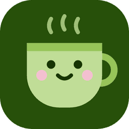

# 美術與視覺識別

這份文件只談 Chatto 的「長相」：品牌概念、色彩、吉祥物、插圖、動態氣質，以及內建聊天室主題的美術方向。怎麼在程式裡套用，見 [`design.md`](design.md)（控制台）與 [`theming.md`](theming.md)（聊天室主題）。

## 概念

Chatto（チャット）＝ お茶 ＋ chat。整個品牌圍繞**一杯熱茶**：實況主一邊喝茶、一邊和聊天室的人聊天。

想傳達的感覺：

- **溫和**：像茶一樣不刺激，長時間開著也不累眼。
- **安靜**：工具退到後面，畫面留給實況主和觀眾。
- **親切**：有一點可愛，但是成熟、不幼稚。
- **日常的和風**：抹茶、和紙、暖簾、茶葉這些日常元素，不走古典或神社風。

不要的方向：霓虹與電競風、大面積漸層與光暈、過度的玻璃擬態、閃亮特效、用 emoji 堆疊出來的可愛。

## 色彩

### 品牌色

| 名稱   | 色碼      | 角色                                     |
| ------ | --------- | ---------------------------------------- |
| 深抹茶 | `#27500a` | 品牌底色：App 圖示、OBS 等待畫面、Hero   |
| 濃茶   | `#173404` | 深抹茶上更深一階的細節（葉脈、貼紙文字） |
| 抹茶   | `#6b9b2e` | 杯口、杯把、強調（亮色介面）             |
| 嫩抹茶 | `#97c459` | 強調（暗色介面）、茶葉的亮部、漣漪       |
| 淡抹茶 | `#c0dd97` | 茶杯杯身、茶葉、蒸氣                     |
| 奶白   | `#f4f9ee` | 深抹茶上的文字、圓盤底                   |
| 櫻     | `#f4c0d1` | 只做點綴：腮紅、茶葉旁的小圓點           |

- 比例大約是 **深抹茶 6、淡抹茶 3、櫻 1 以下**。綠色是主角，櫻色只出現在小地方，一個畫面裡不要超過一兩處。
- 綠色系要偏黃綠（抹茶），不要偏藍綠（薄荷）或螢光綠。
- 暗色介面不是把亮色反轉，而是「夜裡的茶室」：底色是帶一點綠的炭黑（`#121512`），強調色換成較亮的嫩抹茶，櫻色改成較深的 `#993556`。
- 控制台的完整色彩 token 見 [`design.md`](design.md)「色彩」。

## 吉祥物：茶杯

### 造型

- 一個馬克杯，正面朝前，右邊有把手。沒有手腳、沒有配件。
- 杯身：上寬下窄、底部圓弧，顏色是淡抹茶。
- 杯口：一條較深的抹茶色帶，代表茶的水面。
- 把手：抹茶色，粗的圓弧線。
- 臉：兩顆圓點眼睛、一個小小的微笑，兩頰各一個櫻色腮紅（帶一點透明）。臉的位置偏杯身中上，五官集中，看起來比較小、比較可愛。
- 蒸氣：杯口上方三條 S 形短線，中間那條稍微高一點。
- 臉、蒸氣用圓頭的線條（96 格的畫布上約 2.5 的粗細），不用填滿的形狀。

### 畫法

- 扁平色塊，不加外框描邊、陰影、漸層或光澤。
- 只用品牌色：杯身淡抹茶、杯口與把手抹茶、五官深抹茶、腮紅櫻色。蒸氣在控制台是淡灰綠（介面的提示文字色），在深抹茶底上改用淡抹茶。
- 茶杯是品牌標示，亮色與暗色都用同一組品牌色，不跟著介面切換（`TeaCup.tsx` 的 `BRAND`）。只有蒸氣和「z」用介面的提示文字色，讓它們在兩種底色上都看得到。
- 放在深色底上時，墊一個奶白色的圓盤，杯子才不會和底色混在一起（OBS 等待畫面、總覽的 Hero）。
- 原始圖是 96×96 的 SVG（`TeaCup.tsx`），所有地方都用同一張圖，不要另外重畫一個版本。

### 表情

| 表情 | 何時             | 臉                                      | 蒸氣 |
| ---- | ---------------- | --------------------------------------- | ---- |
| 開心 | 已連線、載入中   | 圓點眼、微笑                            | 有   |
| 忙碌 | 聊天很熱絡       | 眼睛變成「^ ^」、微笑                   | 有   |
| 擔心 | 連線出問題       | 圓點眼、嘴角往下                        | 有   |
| 睏   | 還沒連線、空狀態 | 眼睛變成彎彎的閉眼、微笑，旁邊一個「z」 | 沒有 |

- 表情一律溫和，「擔心」也只是嘴角往下，不哭、不生氣。
- 新增表情時只改眼睛和嘴，杯子本身不變形。

### 動作

- 蒸氣緩緩上升、淡出，三條錯開（每條約 2.4 秒一輪）。這是茶杯「活著」的訊號。
- OBS 等待畫面上，茶杯另外會輕輕上下浮動、偶爾眨眼。
- 不搖晃、不彈跳、不轉圈。

## 文字標誌

參考日系品牌識別的做法：粗的訂製字當主標，細的窄體大寫當副標，字距撐開到和主標同寬。

### 主標「CHATTO」

- 不是現成字型，是用同一個粗細的筆畫在網格上搭出來的字：字高 140、筆畫 46，筆畫端點平切。
- **C**：粗的圓弧，開口朝右，端點順著圓心方向切。
- **A**：圓拱頂，不是尖頂；橫線偏低。
- **TT**：兩個 T 共用一條橫線，是 Chatto 專屬的連字，不要拆開。
- **O**：從上往下看的茶杯，中間一圈淡抹茶就是茶（深色底上改用抹茶）。整個字標的茶意象只靠這一點，不另外加茶杯或蒸氣。
- 全大寫、字距緊（字母間距 12，約筆畫的四分之一）。

### 副標「LIVE CHAT OVERLAY」

- 窄體、單一粗細的大寫，筆畫約是主標的四分之一（視覺上），筆畫端點平切。
- 字距撐開到和主標同寬，兩端對齊。
- 不寫平台名稱：Chatto 不只給 Twitch 用。

### 版本與檔案

檔案在 `assets/`，SVG 不依賴字型，可以直接縮放。除了貼紙，每種都有亮底用和深底用（`-dark`）兩個版本，也都有 PNG（長邊 1600 px）。

| 檔案                | 內容                                                      | 用在                   |
| ------------------- | --------------------------------------------------------- | ---------------------- |
| `chatto-logo`       | 主標＋同寬副標                                            | README、關於頁、宣傳圖 |
| `chatto-wordmark`   | 只有主標                                                  | 標題列、小空間         |
| `chatto-stacked`    | CHA／TTO 兩行＋同寬副標                                   | 正方形空間、社群貼文   |
| `chatto-horizontal` | 主標＋折角線＋兩行副標                                    | 頁首、窄長的橫幅       |
| `chatto-stamp`      | 雙圈環形印，中間茶杯 O，外圈繞 LIVE CHAT OVERLAY · CHATTO | 角落浮水印、周邊       |
| `chatto-arch`       | 弧形副標＋主標＋細線與櫻色點＋OBS · DESKTOP               | 等待畫面、海報         |
| `chatto-banner`     | 直排旗：C、H、A、T、T、O 由上往下堆，頂端一條櫻色         | 直式空間、側欄、桌布   |
| `chatto-label`      | 四角折角線框住主標，左上、右下各一行小字                  | 包裝感的封面、下載頁   |
| `chatto-ticket`     | 打洞票券外框＋虛線，主標＋副標                            | 版本發佈公告、贊助感謝 |
| `chatto-sticker`    | 斜放的主標壓在櫻色膠囊上（只有一種配色）                  | 社群、輕鬆的場合       |

- 亮底版：字深抹茶、茶淡抹茶。深底版：字奶白、茶抹茶。方塊、旗子這類「有底」的版本在深底上反過來用奶白底。
- **以英文為主**：所有標誌只用英文，不放片假名。「チャット」只在需要說明名稱由來時用一般文字另外寫。
- 四周至少留 O 的半徑那麼寬的空白。
- 主標寬度小於約 120 px 時拿掉副標，只用主標；再小（例如 favicon）就改用 App 圖示。
- 不要拉長壓扁、加描邊或陰影、換顏色組合，也不要把 O 換成其他圖形。

### GitHub 封面

repo 的 Social preview（分享連結時的預覽圖），1280×640。上傳位置：GitHub repo 的 Settings → General → Social preview。

| 檔案                     | 內容                                                                                          |
| ------------------------ | --------------------------------------------------------------------------------------------- |
| `chatto-cover-brand.png` | 深抹茶底，置中的主要版，四角折角線，左上 OBS · DESKTOP · OPEN SOURCE、右下 MADE FOR STREAMERS |
| `chatto-cover-chat.png`  | 左半奶白底放主要版與 DESKTOP · OBS · THEMES · ALERTS，右半深抹茶底放「泡泡」主題的聊天室      |

- 同名的 `.svg` 是原稿（聊天文字用內嵌的粉圓）。
- 封面上的聊天室要照內建主題的真實樣子畫，事件文字用產品實際的英文模板；徽章、表情用自繪的，不用平台的圖。
- 只寫已經支援的功能和平台。
- 底色只用色板裡的顏色（奶白、深抹茶）。

## App 圖示

- 圓角方形，深抹茶底，正中間是開心的茶杯（含蒸氣），佔畫面大部分。
- 不放文字、不放外框。
- 小尺寸（工作列、系統匣）也要認得出杯子和臉，所以五官不再加細節。
- 檔案：`assets/chatto-icon.svg`（原稿，網站的 favicon 也用它）、`assets/chatto-icon.png`（256 px，給 README 等只吃點陣圖的地方）；App 打包用的是 `apps/desktop/resources/icon.png`，內容相同。

## 插圖與裝飾

整體風格和茶杯一致：**扁平、兩三個顏色、圓角、簡單幾何**，看起來像同一個人畫的。

- **茶葉**：橢圓尖頭的葉子，淡抹茶色，中間一條深色主葉脈加幾條斜的側脈；常兩片一組、放在對角，旁邊點一顆櫻色小圓點。用在「茶葉框」主題的外框。
- **漣漪**：從茶杯圓盤往外擴散的圓圈，亮色細邊加內側淡淡的漸層，像茶水表面的波紋。用在 OBS 等待畫面。
- **茶葉彩紙**：第一次連線成功時，從狀態點冒出的一小團淡綠、嫩綠、抹茶色碎片。數量少、只出現一次。
- 空狀態不另外畫插圖，用睏的茶杯。

製作素材：

- 一律自己畫，或使用 CC0 素材。
- 點陣圖用 4 倍尺寸畫好再縮小，邊緣才會平滑（茶葉框是用 Pillow 這樣做的）。
- 平台標誌（Twitch 等）用官方圖形（Simple Icons，CC0），不要自己改畫。

## 字型的氣質

- 介面用 **jf open 粉圓**：圓潤、親切，和茶杯的圓弧呼應。
- 數字與程式碼用 JetBrains Mono，讓數字看起來穩定、整齊。
- 聊天室主題可以選思源黑體（中性）、思源宋體（書卷、和紙）或 JetBrains Mono（終端機）。

## 動態的氣質

像熱茶一樣**慢而柔**：

- 長時間的動態（蒸氣、漣漪、浮動）週期在 2～6 秒，用 ease-in-out，不要有急停。
- 介面上的回饋（切頁、高亮滑動）短而輕，0.2 秒左右，用彈簧但不明顯回彈。
- 慶祝的時刻只有一個（第一次連線），規模要小。
- 不做閃爍、脈衝、發光、掃光。

## 內建聊天室主題

內建主題是 Chatto 美術風格的延伸：每個都有清楚的意象，色彩溫和，在各種直播畫面上都讀得清楚。

| 主題     | 意象               | 色彩                                     | 形狀與字型                                 | 動態     |
| -------- | ------------------ | ---------------------------------------- | ------------------------------------------ | -------- |
| 抹茶玻璃 | 一杯透光的冰抹茶   | 半透明深綠底、淡薄荷名字、淡綠文字       | 12px 圓角、細的淡色邊                      | 預設     |
| 和紙     | 寫在和紙上的留言   | 米色紙底、墨色文字、茶褐色名字、朱紅強調 | 近乎直角、思源宋體                         | 淡入     |
| 泡泡     | 手機聊天的對話泡泡 | 淡珊瑚底、深茶色文字、珊瑚色強調         | 大圓角、一角收尖；事件加珊瑚邊框與歪斜貼紙 | 彈出     |
| 極簡描邊 | 遊戲字幕           | 白字黑描邊、薄荷名字、金色強調           | 沒有底，只有字，字級稍大                   | 預設     |
| 暖簾     | 店門口的暖簾       | 深藍布色、名字在更深的布塊上、金色強調   | 名字與內容左右兩塊、6px 圓角               | 從左滑入 |
| 終端機   | 開發者的終端機     | 近黑底、灰白文字、青綠名字與強調         | 等寬字、`@` 前綴、顯示時間、一整塊面板     | 無       |
| 茶葉框   | Chatto 本身        | 深色底配淡抹茶外框、櫻色強調             | 九宮格圖片外框，對角兩片茶葉               | 彈出     |

- 每個主題都要能放在**明亮的遊戲畫面**和**深色的畫面**上：要嘛有自己的底色，要嘛像極簡描邊一樣有描邊。
- 每個主題要有自己的強調色，用在提及、事件標題、新留言提醒，和主要文字明顯區分。
- 事件訊息（訂閱、揪團）要和一般留言看得出差別，但屬於同一套風格，例如泡泡用邊框和貼紙、和紙用朱紅標題。
- 新增內建主題時，先寫一句意象（「一杯透光的冰抹茶」），再從意象決定色彩、形狀、動態。不做只是換顏色的主題。
- 內建主題的圖片必須自製或 CC0。
- 圖示用自繪圖形，不用 emoji。**例外**：茶葉框的事件訊息用 🍵 當圖示，呼應主題本身的茶意象；其他主題不比照。

## OBS 等待畫面

Chatto 沒開時，OBS 裡的「Chatto 聊天室」來源會顯示這個畫面。直播觀眾也看得到，所以它是品牌最常對外露臉的地方。

- 滿版深抹茶底。
- 正中間奶白圓盤，裡面是開心的茶杯：蒸氣上升、輕微浮動、偶爾眨眼。
- 從圓盤往外擴散的漣漪，每 3 秒一圈，慢慢淡出到畫面外。
- 下方一行奶白色文字「連線至 Chatto 中」加三個依序亮起的點。
- 所有尺寸跟著來源大小縮放，任何長寬比都要好看。
- 整體要安靜：觀眾看到時只會覺得「聊天室在準備中」，不會被吸走注意力。

## 尚未定義

- 茶杯以外的角色、季節或活動版本的茶杯。
- 宣傳圖、商店頁截圖的版面。

要做這些之前，先在這份文件補上方向。
